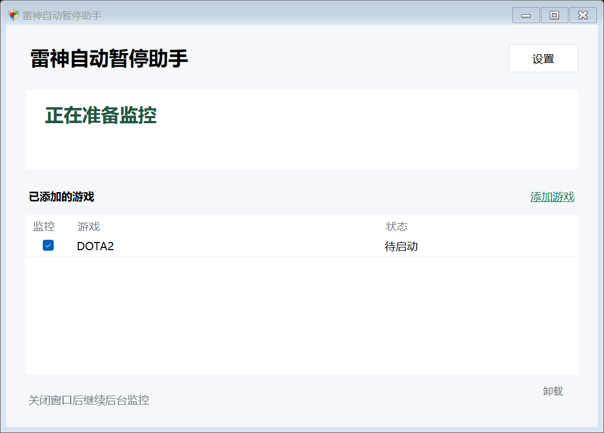
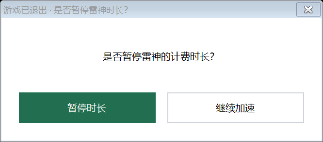

# 雷神自动暂停助手

游戏退出后提醒你暂停雷神计费时长。**只有你点击“暂停时长”才会执行暂停**；关闭提醒、选择继续加速或游戏重启，都不会自动扣停。

[下载 Windows 64 位版](https://github.com/PyFangs/leigod-auto-pause/releases/latest) · [直接下载 v2.4.0](https://raw.githubusercontent.com/PyFangs/leigod-auto-pause/main/dist/leigod-auto-pause-v2.4.0-win-x64.zip) · [详细使用说明](docs/usage.md) · [实现与数据说明](docs/architecture.md) · [测试记录](docs/testing.md)

## 能做什么

- 自动添加本机已安装的 Steam 游戏，支持多个游戏库。
- 游戏运行过并退出后，等待 0–600 秒再询问是否暂停。
- 游戏重启会取消提醒；Steam 或启动器留在后台不会单独阻止提醒。
- 需要暂停时自动唤回托盘中的雷神；核对暂停结果，成功后不再额外弹窗。
- 新用户首次运行会请求所需管理员权限并启用开机运行，主窗口保持可见；之后开机才在后台运行。
- 没有预置 DOTA2 或其他游戏。特殊位置、非 Steam 游戏可通过“手动添加游戏”补充。

- 第一次点击“×”会说明托盘行为；右下角提供小型“卸载”入口，确认后移除助手的启动项、程序及本地配置记录。

## 下载与安装

1. 从上方下载链接获取 ZIP，解压到准备长期保留的目录。
2. 双击 **雷神自动暂停助手.exe**。首次确认 Windows 权限提示后自动启用开机运行。
3. 正常在雷神中加速并启动游戏，退出时按提醒选择即可。

支持 **Windows 10/11 x64**，需要 Windows 简体中文文字识别组件。程序无需安装器，默认不开启任何需要输入账号的工具登录。取消权限确认后仍可打开程序，在设置中重试。





## 怎样实现，数据会去哪里

这是非官方的本地工具，公开源码供审阅。读取 Steam 本机安装清单及雷神本地缓存中的游戏名称、启动编号和路径，以实际进程路径判断游戏是否退出；使用 Windows 本地 OCR 读取雷神窗口，通过正常界面点击“暂停时长”，随后核对“开启时长”等暂停状态。

**不调用雷神账号接口，不提取或上传账号密码、Cookie、Token，不向远程服务上传游戏记录；不注入游戏/雷神进程，不修改它们的程序文件。** 程序本身没有联网、遥测或自动更新功能。开机运行会创建当前用户的 Windows 计划任务，配置和记录保存在本机，详见[数据与权限说明](docs/architecture.md)。

“免安装”不代表不写入任何本地文件，也不代表没有管理员权限。发布的可执行文件目前没有代码签名，不作“绝对安全”保证；可核对下载校验值并审阅或自行构建源码。

## 适用范围与限制

DOTA2 已由使用者实际验证。其他游戏经过通用状态、安装清单、路径监控及独立模拟客户端测试，**不代表已逐款实玩验证**。Windows 对部分中文字体、较小文字或被截断的游戏名可能识别不准，导致漏提醒；无法可靠关联的加速游戏会阻止自动暂停。雷神界面或缓存格式更新后可能需要更新本工具。

详细设置、添加游戏、升级、卸载和排错见 [使用说明](docs/usage.md)。

## 源码与自测

C# / .NET Framework / Windows Forms / Windows 本地 OCR，无额外 NuGet 依赖。构建与测试命令：

```powershell
.\src\build.ps1 -OutputPath .\LeigodGuard.exe
.\src\tests\run-tests.ps1
```

完整界面测试会短暂显示独立模拟窗口，只启动临时测试进程并点击模拟按钮。后台环境可加 `-SkipClientClickTest`，跳过需要前台桌面的 OCR 点击测试。源码公开用于审阅，仓库尚未指定开源许可证。

